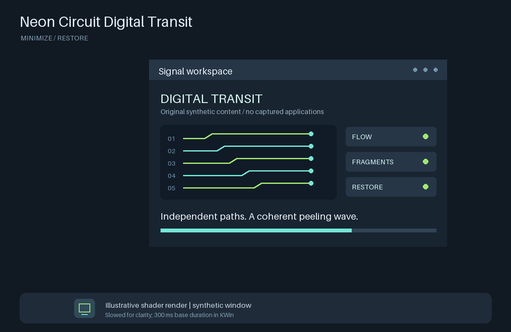

# Neon Circuit Digital Transit

A standalone **KWin / Plasma 6 minimize and restore effect** by
[ThePowershellNinja](https://github.com/ThePowershellNinja).
A directional peeling wave breaks the captured window into irregular, scanlined
fragments. Independent overlapping curves carry them into the native task icon;
restore retraces the same seeded paths and joins directly into an intact window.
The portion the wave has not reached stays seamless and undistorted.



**Illustrative preview, slowed for clarity.** This is the actual fragment shader
rendering an original synthetic window on a neutral background, not a desktop
recording. [Still image](docs/preview.png). No application data, wallpaper, task
widget, or full desktop theme is included.

## Install

Requires Plasma 6 with KWin's OpenGL compositing and the `kpackagetool6` command
(provided by your distribution's KDE Frameworks 6 KPackage tools). This is not a
GNOME extension or a Plasma 5 package.

1. Download `neon-circuit-digital-transit-0.1.0.tar.gz` and `SHA256SUMS` from
   [v0.1.0](https://github.com/ThePowershellNinja/neon-circuit-digital-transit/releases/tag/v0.1.0).
   Use the **release asset**, not GitHub's automatically generated source archive.
2. In the download directory, verify and install:

   ```sh
   sha256sum --check SHA256SUMS
   kpackagetool6 --type KWin/Effect --install neon-circuit-digital-transit-0.1.0.tar.gz
   ```

3. Open **System Settings > Window Management > Desktop Effects**, search for
   **Neon Circuit Digital Transit**, enable it, and Apply. Disable competing
   minimize effects such as Magic Lamp or Squash. The effect is not enabled
   automatically by installing it.

The stable plugin ID is `neon-digital-minimize`. A per-user install normally lives
at `~/.local/share/kwin/effects/neon-digital-minimize/`. No custom task manager,
panel layout, output name, theme, or wallpaper is required.

### Upgrade or remove

Disable the effect and Apply before upgrading; then enable it and Apply again
to load the new code.

```sh
kpackagetool6 --type KWin/Effect --upgrade neon-circuit-digital-transit-0.1.0.tar.gz
```

Use the filename of the new release when upgrading later. If migrating from a
private copy with the same ID but a higher version (for example `1.0`), KPackage
may reject a downgrade: disable it, remove that package, then install this release.
Saved settings are not reset by packaging.

To remove, disable it in Desktop Effects and Apply, then run:

```sh
kpackagetool6 --type KWin/Effect --remove neon-digital-minimize
```

## Compatibility and native targets

- **Known tested runtime:** Nobara, Plasma/KWin **6.7.5**, **Wayland**, AMD Radeon
  **RX 7800 XT**, Mesa. Other Plasma 6 releases, GPUs, drivers, X11, mixed-DPI
  layouts, HDR/color-managed output, and particular third-party docks have not
  been verified in live KWin sessions.
- The JavaScript effect uses a GLSL **140** fragment shader and KWin's
  `colormanagement.glsl`. It affects **minimize/restore only**, not
  maximize, opening, closing, or other desktop animations. It skips unsupported
  window types and transitions while a full-screen desktop effect is active.
- KWin supplies `window.iconGeometry`. The package accepts finite, positive native
  geometry with a center inside the virtual desktop bounds: **top, bottom, left,
  right, and another output** are all allowed, including negative coordinates.
  Those target directions and multi-output coordinates have automated regression
  coverage; they are not a claim of live testing on every panel/dock arrangement.
- **KWin chooses among the task icon geometries applications/panels publish.**
  With multiple panels it may choose an icon on another display. This effect
  follows that geometry rather than guessing a different icon. A dock that does
  not publish usable geometry cannot provide a real target. Autohide/layout
  changes can also temporarily leave no usable target.
- The source texture is captured before a bounded layout wait (up to 24 nominal
  16 ms retry animations). If no usable native target appears, the flight is
  skipped, temporary shader animations finish, blur state is cleared, and KWin
  receives a warning. There is no made-up corner or hardcoded top-bar fallback.
  Geometry is bounded by the virtual desktop rectangle, not used to infer panel
  edges or fill gaps between displays.

## Timing and performance

The public base duration is **300 ms**, passed through KWin's `animationTime()`
so KDE's global animation speed is honored. For example, a factor of `0.8`
gives **240 ms**; a zero factor skips the flight. A saved per-effect `Duration`
overrides the new-install default. This release does not reset existing settings.

There is no custom configuration UI in v0.1.0. Advanced settings are `Duration`
(unsigned milliseconds) and `Diagnostics` (boolean) in the
`[Effect-neon-digital-minimize]` group of `kwinrc`. After manual edits, disable
the effect, Apply, then enable it and Apply; a full unload/load may be needed
rather than an ordinary reconfigure. Diagnostics and missing-target warnings can
include window captions: remove private titles before sharing logs.

A 700 x 440 window uses **504 pieces**; large windows are capped at **720**.
Conservative flight-X/row culling and a shuffled nested draw order limit work
without dropping fragments. The bottom-up redirected texture and top-down
geometry are deliberately converted on both destination and source Y axes.

The included offscreen benchmark on the tested RX 7800 XT measured roughly
**1.3-3.3 ms median** GPU time for 700 x 440 windows across eight target directions,
and **14 ms median / 19 ms maximum** for a 2560 x 1400 fixture. These are sample
shader timings, not end-to-end desktop latency or a guaranteed frame budget:
large windows, high resolutions, concurrent flights, and slower hardware can
miss a refresh deadline. The renderer uses identity color conversions for a
synthetic SDR texture, so it does not validate KWin's HDR/color pipeline.

## Build a shareable package

Only Python 3's standard library is needed to package:

```sh
python3 tools/package.py
```

This validates metadata/configuration and writes
`dist/neon-circuit-digital-transit-0.1.0.tar.gz` and `dist/SHA256SUMS`.
The archive root contains exactly:

```text
metadata.json
contents/code/main.js
contents/config/main.xml
contents/shaders/digital.frag
LICENSE
```

Version comes from `effect/metadata.json`; the tar/gzip headers are normalized.
The same inputs and Python/zlib toolchain produce the same archive bytes.
Different compressors (for example zlib and zlib-ng) can produce different gzip
bytes for the identical normalized tar payload; verify downloads against the
published release's `SHA256SUMS`, not a locally recompressed archive.
Previews, tests, development
tools, home-directory data, and this README are not installed. The GitHub source
ZIP is a development checkout, **not** the installable KWin package.

## Development checks

The packaging check has no Python dependencies. If `kpackagetool6` is present it
also installs, inspects, upgrades a temporary version, and removes the package
using **temporary XDG directories and an explicit temporary package root**.
It never installs over the user's effect.

```sh
python3 -m unittest discover -s tests -p 'test_package.py' -v
```

For JavaScript and shader-reference regressions, use Python 3.12+ and a virtual
environment:

```sh
python3 -m venv .venv
. .venv/bin/activate
python3 -m pip install -r tests/requirements.txt
python3 -m unittest discover -s tests -p 'test_targets.py' -v
python3 tests/test_piece_paths.py
```

The target suite runs the **shipped main.js in Qt's JavaScript engine** with a
mock effect API. It checks all panel edges, negative/other-output coordinates,
invalid/missing targets, bounded waits, early capture, uniform update ordering,
reverse/reversal seeds, animation scaling, and cleanup (including KWin's
animation-ended ID `0`, which must not be canceled from its callback). The CPU
reference checks source orientation, partition coverage/density, seamless
peeling/joins, eight-direction wave/culling bounds, overlap, and seed diversity.

Optional GPU checks and preview generation need an offscreen-capable OpenGL
context and the same dependencies:

```sh
QT_QPA_PLATFORM=offscreen python3 tests/benchmark_shader.py
QT_QPA_PLATFORM=offscreen python3 tools/render_preview.py
```

These create no application windows and never capture/control the desktop.
The GPU test compiles the shipped shader, checks intact unreached source pixels,
and compares culling-enabled/disabled renders at several phases across eight
directions. The comparison toggles culling in one compiled program to avoid
cross-program rounding differences at source-cell boundaries. For strict pixel
comparison the benchmark also disables Mesa radeonsi's uniform-specialized
shader variants **in that test process only**; asynchronous variant replacement
otherwise produced intermittent boundary-pixel differences. Timing uses the
unmodified production shader with that test-only driver option, so normal KWin
performance can differ. This does not change the shader or any desktop setting.
Preview generation verifies source orientation and
the fully minimized endpoint; only its generated original content enters the GPU.
On systems without offscreen OpenGL, these two checks are optional, not evidence
of tested GPU compatibility.

CI runs the non-GPU checks and uploads the reproducible package/checksum as a
build artifact. Tagged public releases are published separately after validation.

## KDE Store

GitHub hosts source code and releases; it **does not submit to KDE Store**.
See [the prepared listing copy and submission steps](docs/kde-store.md).
Upload the installable release archive under **KWin Effects Plasma 6**
([KWin Effects](https://store.kde.org/browse?cat=209&ord=latest), choosing the
Plasma 6 subcategory as applicable). The user must log in and create the listing.
A Store listing is not inclusion in KDE core or a distribution package.

## License

[MIT](LICENSE), including the code and original synthetic preview artwork.
The distributed effect includes the actual license text.
This is an independent community effect, not an official KDE product.
